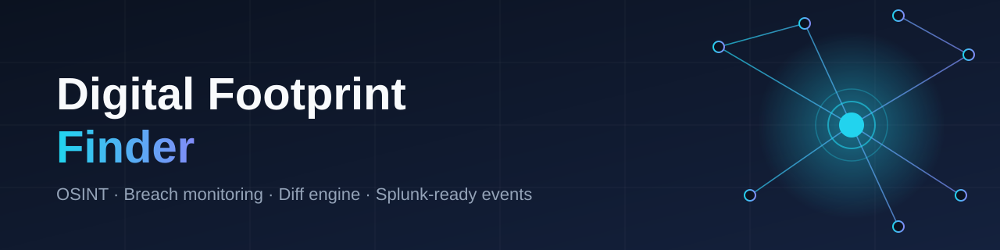
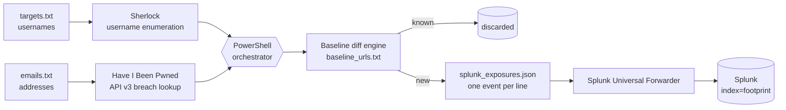

<div align="center">



# Digital Footprint Finder

**A local-first OSINT and breach-monitoring pipeline that finds where a person's identity is exposed online, reports only what is *new*, and ships the findings to Splunk as structured events.**


[Overview](#overview) · [How it works](#how-it-works) · [Quick start](#quick-start) · [Splunk](#splunk-integration) · [Roadmap](#roadmap) · [Responsible use](#responsible-use)

</div>

---

## Overview

Most of a person's exposure is not one big leak. It is hundreds of small ones: reused usernames on forgotten platforms, email addresses in old breach dumps, profiles on sites you never visit. Commercial removal services charge a yearly fee for a black-box version of this.

This project is a transparent, scriptable alternative that you run on your own machine. It answers one question each time it runs:

> **What is exposed about me today that I did not already know about yesterday?**

It checks usernames and email addresses, compares the results against a saved baseline, and surfaces only the **new** findings. Each new finding is written as a JSON event that Splunk can ingest.

**Why I built it:** to practise the loop a SOC analyst works in every day: collect, normalise, de-duplicate, alert, and investigate. The subject here is my own attack surface.

## How it works



| Stage | What happens |
|---|---|
| **Collect** | [Sherlock](https://github.com/sherlock-project/sherlock) checks each username against hundreds of sites. The HIBP v3 API returns every breach containing each email address. |
| **Normalise** | Every hit becomes a single indicator string: a profile URL, or `hibp://breach/<email>/<breach>`. |
| **Diff** | Indicators are compared with a local baseline. Anything already seen is dropped, so a second run on an unchanged footprint reports nothing. |
| **Emit** | New indicators are appended to the baseline and written as one JSON event per line, ready for Splunk. |

### Design decisions

- **Local-first.** No cloud service sees your target list. Raw scan output stays on disk.
- **Noise control.** The diff engine means an alert is a *change*, not a repeat of everything already known.
- **Secrets stay out of code.** The HIBP key is read from a Windows user environment variable and is never written to a file.
- **PII stays out of Git.** The repository ships with an allow-list `.gitignore`: only the script, docs and `*.example.txt` templates can be committed. Target lists, baselines, raw scans and event logs cannot.
- **SIEM-native output.** Events use flat, consistent field names so SPL searches stay simple.

## Event format

Each new exposure is one line of JSON. The values below are synthetic.

```json
{"timestamp":"2026-10-15T01:42:25Z","host":"WORKSTATION","event_type":"new_footprint_exposure","status":"Found","source":"Sherlock","indicator":"https://example.com/exampleuser","action_required":"Review / Remediate / Opt-Out"}
{"timestamp":"2026-10-15T01:42:27Z","host":"WORKSTATION","event_type":"new_footprint_exposure","status":"Found","source":"HaveIBeenPwned","indicator":"hibp://breach/user@example.com/ExampleBreach","action_required":"Review / Remediate / Opt-Out"}
```

## Quick start

### Requirements

- Windows 10/11 with PowerShell 5.1+ (PowerShell 7 also works)
- Python 3.9+
- A [Have I Been Pwned API key](https://haveibeenpwned.com/API/Key) (paid) for the breach lookup. Without one, the script skips that stage and still runs Sherlock.

### Install

```powershell
git clone https://github.com/sagarbid/digital-footprint-finder.git
cd digital-footprint-finder

python.exe -m pip install --upgrade pip
python.exe -m pip install sherlock-project
```

### Configure

```powershell
# 1. Copy the templates and fill in your own details (these files are git-ignored)
Copy-Item targets.example.txt targets.txt
Copy-Item emails.example.txt  emails.txt

# 2. Store your HIBP key as a user-level environment variable
[System.Environment]::SetEnvironmentVariable("HIBP_API_Key", "YOUR_API_KEY_HERE", "User")
# Restart PowerShell so the variable is picked up
```

### Run

```powershell
powershell.exe -ExecutionPolicy Bypass -File .\footprint_finder.ps1
```

The first run populates the baseline, so expect a longer list. Every later run reports only what changed.

## Splunk integration

The script writes `splunk_exposures.json` next to itself. To ingest it with a Universal Forwarder, see [docs/splunk-ingestion.md](docs/splunk-ingestion.md), which includes an `inputs.conf` stanza and example SPL searches.

## Repository layout

```
digital-footprint-finder/
├── footprint_finder.ps1      # orchestrator: collect, diff, emit
├── targets.example.txt       # template: one username per line
├── emails.example.txt        # template: one email per line
├── docs/
│   └── splunk-ingestion.md   # forwarder config + example SPL
├── assets/
│   └── banner.svg
├── SECURITY.md               # responsible use + data handling
├── LICENSE
└── .gitignore                # allow-list: private data cannot be committed
```

## Current limitations

I would rather state these plainly than have a reader find them:

- **Detection only.** The tool finds exposures and logs them. It does not yet submit opt-out or removal requests.
- **Two sources today.** Sherlock and HIBP are integrated. Other sources are on the roadmap.
- **Sherlock produces false positives.** Some sites return a page for any username. Treat hits as leads to verify, not confirmed accounts.
- **Windows-first.** The orchestrator is PowerShell. A Bash port for Linux is planned.
- **No dashboard shipped yet.** The events are Splunk-ready, and the dashboard is on the roadmap.

## Roadmap

- [ ] Add [Holehe](https://github.com/megadose/holehe) for email-to-service registration checks
- [ ] HTML/PDF summary report per run
- [ ] Splunk dashboard (exposures over time, by source) exported as XML
- [ ] Opt-out request templates referencing the Australian Privacy Act 1988 (APP 12 and 13) and GDPR Article 17
- [ ] Removal tracker: requested, confirmed, re-appeared
- [ ] Bash port for Linux, and scheduled monthly re-scans
- [ ] Unit tests for the diff logic

## Responsible use

Use this tool **only on identities you own or have explicit written permission to assess.** Do not use it to profile, track or harass other people. See [SECURITY.md](SECURITY.md).

## About the author

**Sagar Bidari**, Melbourne, Australia. Career-changing from hospitality leadership into cybersecurity.

- CompTIA Security+ CE (SY0-701)
- Monash University Cybersecurity Bootcamp (Splunk, Nessus, incident response)
- Bachelor of Business (Information Systems Management), Victoria University
- Australian citizen, eligible for NV1/NV2 clearance
- Portfolio: [bidarisagar.com](https://bidarisagar.com) · [LinkedIn](https://linkedin.com/in/sagarbidari)

This is a home-lab project, not commercial work. I built it with AI assistance (Claude) as part of my learning workflow, and I reviewed and ran the result myself.

## License

[MIT](LICENSE)
